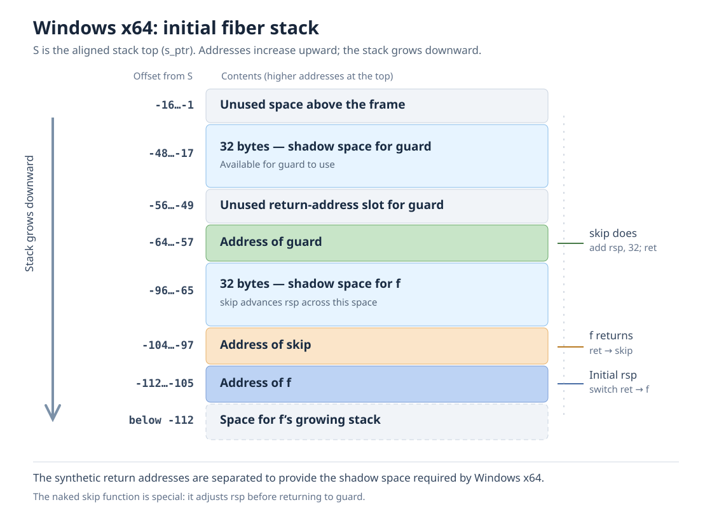

# e-fibers-windows

This is a version of the fibers example presented in the book, but with the
additional code needed to switch stacks on Windows. The same example can run on
x86-64 Linux, macOS, and Windows, although the Windows implementation needs a
little more work to satisfy its calling convention.

## Technical requirements

An x86-64 CPU running Linux, Windows, or an x86-64 version of macOS. This
example does not support Arm-based Macs or other CPU architectures.

## Running the example

The `#[unsafe(naked)]` attribute and `naked_asm!` macro were stabilized in
Rust 1.88, so **Rust 1.88 or newer** is sufficient. You can run the example
with:

```console
cargo run
```

If you are using an older Rust toolchain for the original book examples, update
it with `rustup update stable` before running this version.

## Safety

The same disclaimer regarding safety as we made for the `c-fibers` example
still applies. We manually manage stacks and context switches here, which is
not something Rust can make safe for us. This is an educational example, not a
production-ready fiber implementation. In particular, using a `Vec<u8>` as a
Windows stack does not reproduce all the stack guard, stack probing, and
exception-unwinding facilities of a Windows-managed stack.

## Detailed explanation of the changes made to support Windows

Our example works on x86-64 Linux, macOS, and Windows. Unfortunately, newer
Macs with Apple's M-series chips use a different architecture, so this example
does not work on those machines without further changes.

You might wonder why I didn't include Windows support in the original example.
The reason is that most of these platform-specific details aren't particularly
relevant for understanding the main concepts of how fibers work.

Here we'll go a bit further to explore how to set up a stack for Windows and
perform a context switch. We might not get all the way to a perfect
implementation, but there are plenty of references to explore further:

- [Microsoft's x64 calling convention](https://learn.microsoft.com/en-us/cpp/build/x64-calling-convention)
- [Microsoft's x64 stack usage](https://learn.microsoft.com/en-us/cpp/build/stack-usage)
- [Win64/AMD64 API](https://wiki.lazarus.freepascal.org/Win64/AMD64_API) — a useful summary of the differences between System V and Windows x64
- [Handmade Coroutines for Windows](https://probablydance.com/2013/02/20/handmade-coroutines-for-windows/) — a very good read about a coroutine implementation
- [Boost.Context assembly](https://github.com/boostorg/context/blob/develop/src/asm/ontop_x86_64_ms_pe_gas.asm) — another useful reference for further study

### What's special about Windows?

Windows has more **callee-saved** registers (also called *non-volatile*
registers) than the System V ABI used on Linux and macOS. We therefore need to
save more data during a context switch. We also have to account for some
Windows-specific stack metadata and the differences in the calling convention
when setting up a new stack and calling our naked assembly function.

> Supporting Windows adds a fair amount of conditional compilation without
> changing much of what we need to understand the basic idea behind fibers.
> That doesn't make it less interesting, though. We'll see firsthand some of
> the difficulties of supporting multiple platforms when doing everything
> from scratch.

### Additional callee-saved (non-volatile) registers

The first change is that Windows requires us to preserve `XMM6`–`XMM15` in
addition to the registers already present in the original example. The `rdi`
and `rsi` registers are also non-volatile on Windows, whereas the System V ABI
uses them for its first two integer/pointer arguments.

The XMM registers are 128 bits wide, so we'll represent each one with a pair of
`u64` values, `[u64; 2]`. That gives us the necessary 16 bytes of storage per
register, but **does not, by itself, guarantee 16-byte alignment**. We'll
address that shortly because our assembly uses `movaps`, which requires an
aligned memory operand.

### The Thread Information Block

The next difference is a little less obvious. Windows keeps information about
the current operating-system thread in its **Thread Information Block**
(`NT_TIB`), including the *Stack Base* and *Stack Limit*.

On x86-64 Windows, the `gs` segment provides access to this thread-local
structure. More precisely, the stack values are in memory *relative to* the
`gs` segment base; the `gs` register does not itself contain these values.

> **What is the GS register?**
>
> The `fs` and `gs` segment registers have a history going back to segmented
> memory addressing. Today, operating systems also use segment-based
> addressing for thread-specific data. Windows x64 uses `gs` to access the
> thread's information block. If you're curious about the history, the
> [Multics article](https://en.wikipedia.org/wiki/Multics) is an interesting
> place to start.

When we switch fibers, our assembly saves the old stack base and limit and
restores the values associated with the new stack. We'll use the names
`stack_start` and `stack_end`, corresponding to the high and low ends of our
allocated stack, since they are easier to mentally parse when the stack grows
downward.

### Alignment of ThreadContext

Here is the complete Windows version of `ThreadContext`, including the
additional registers and stack information:

```rust
#[cfg(target_os = "windows")]
#[derive(Debug, Default)]
#[repr(C, align(16))]
struct ThreadContext {
    xmm6: [u64; 2],
    xmm7: [u64; 2],
    xmm8: [u64; 2],
    xmm9: [u64; 2],
    xmm10: [u64; 2],
    xmm11: [u64; 2],
    xmm12: [u64; 2],
    xmm13: [u64; 2],
    xmm14: [u64; 2],
    xmm15: [u64; 2],
    rsp: u64,
    r15: u64,
    r14: u64,
    r13: u64,
    r12: u64,
    rbx: u64,
    rbp: u64,
    rdi: u64,
    rsi: u64,
    stack_start: u64,
    stack_end: u64,
}
```

The `#[repr(C)]` part keeps the fields in their declared order and uses a
predictable, C-compatible layout. The `align(16)` part ensures that each
`ThreadContext` starts on a 16-byte boundary. Since the XMM fields occupy 16
bytes each and are placed first, every one of them also starts on a 16-byte
boundary. This is important because we're using the aligned `movaps`
instruction when saving and restoring those registers.

There are similar instructions that allow unaligned memory accesses, such as
`movups` and `movdqu`. We could use one of those instead, but we'll keep the
aligned instructions here and make sure our data is correctly aligned. The
choice of `movaps` doesn't depend on whether a particular XMM register
currently contains floating-point or integer data; these instructions copy
its bits either way.

If you want to explore the performance characteristics of these instructions,
have a look at [Agner Fog's instruction tables](https://www.agner.org/optimize/instruction_tables.pdf).

> **A real bug we encountered:** Without `align(16)`, the context could be
> allocated at an address divisible by 8 but not by 16. The first `movaps`
> could then fault, causing an access violation. Adding the alignment
> attribute fixed that problem in our Windows test.

Notice that all Windows-specific definitions are marked with
`#[cfg(target_os = "windows")]`, while the original versions are marked with
`#[cfg(not(target_os = "windows"))]`.

### The Windows stack: 32 bytes of shadow space

There is one more important difference from the System V example. On Windows
x64, **the caller must reserve 32 bytes of shadow space** (also called *home
space*) for a function it calls, even if that function takes no arguments.
The callee may use this area, so we must not place another live return address
inside it.

In our original example, we arranged three function addresses close together
on the new stack: `f`, `skip`, and `guard`. That arrangement isn't sufficient
on Windows. We need to leave room for the shadow space that `f` and `guard`
can use.

Here is the layout we're going to create. `S` is our 16-byte-aligned stack
top, called `s_ptr` in the code. The offsets are byte offsets *below* that
address:



The important addresses are:

| Address | Contents |
| --- | --- |
| `S - 112` | Address of `f`; initial `rsp` |
| `S - 104` | Address of `skip`; return address for `f` |
| `S - 96` through `S - 65` | 32 bytes of shadow space available to `f` |
| `S - 64` | Address of `guard` |
| `S - 56` through `S - 49` | Unused return-address slot for `guard` |
| `S - 48` through `S - 17` | 32 bytes of shadow space available to `guard` |

Notice that the first two pointers are still adjacent. After `switch` executes
`ret`, execution begins in `f`, with `rsp` pointing at the address of `skip`.
That's the layout a normal call would have produced for `f`, and its 32-byte
shadow space starts immediately above the return address.

When `f` returns, it enters our small `skip` function. At that point, `rsp`
points to the beginning of `f`'s shadow space. We advance `rsp` by 32 bytes
and then use `ret` to pick up the address of `guard`. This gives `guard` the
stack alignment and shadow space expected by the Windows x64 calling
convention.

#### Updated Windows spawn function

All we change in `spawn()` is the initial placement of the function pointers
and the starting value of `rsp`. We still initialize the same stack metadata.
The complete Windows function is:

```rust
#[cfg(target_os = "windows")]
pub fn spawn(&mut self, f: fn()) {
    let available = self
        .threads
        .iter_mut()
        .find(|t| t.state == State::Available)
        .expect("no available thread.");

    let size = available.stack.len();

    unsafe {
        let s_ptr = available.stack.as_mut_ptr().offset(size as isize);
        let s_ptr = (s_ptr as usize & !15) as *mut u8;
        std::ptr::write(s_ptr.offset(-64) as *mut u64, guard as *const () as u64);
        std::ptr::write(s_ptr.offset(-104) as *mut u64, skip as *const () as u64);
        std::ptr::write(s_ptr.offset(-112) as *mut u64, f as *const () as u64);
        available.ctx.rsp = s_ptr.offset(-112) as u64;
        available.ctx.stack_start = s_ptr as u64;
        available.ctx.stack_end = available.stack.as_ptr() as u64;
    }

    available.state = State::Ready;
}
```

These offsets preserve the intended 16-byte alignment for `f` and `guard`.
They also give each function its own shadow space without changing our
scheduler or context-switch assembly.

#### Updated Windows skip function

The original non-Windows `skip()` only needs one instruction:

```rust
#[cfg(not(target_os = "windows"))]
#[unsafe(naked)]
unsafe extern "C" fn skip() {
    naked_asm!("ret")
}
```

For Windows, we need one extra instruction:

```rust
#[cfg(target_os = "windows")]
#[unsafe(naked)]
unsafe extern "C" fn skip() {
    naked_asm!(
        "add rsp, 32",
        "ret"
    )
}
```

The `add rsp, 32` skips the 32-byte shadow space that was reserved for `f`.
The following `ret` picks up `guard` from the stack. Our `skip` function is
naked precisely because it is a tiny piece of hand-written stack control,
not an ordinary compiler-generated function body.

### Updating the context switch

Lastly, we need to update `switch()` so it saves and restores the additional
registers and the Windows stack metadata. The arguments also follow the
Windows convention: `rcx` holds the old context pointer and `rdx` holds the
new one, rather than the `rdi` and `rsi` used by System V.

The Windows version is:

```rust
#[cfg(target_os = "windows")]
#[unsafe(naked)]
#[unsafe(no_mangle)]
unsafe extern "C" fn switch() {
    naked_asm!(
        "movaps      [rcx + 0x00], xmm6",
        "movaps      [rcx + 0x10], xmm7",
        "movaps      [rcx + 0x20], xmm8",
        "movaps      [rcx + 0x30], xmm9",
        "movaps      [rcx + 0x40], xmm10",
        "movaps      [rcx + 0x50], xmm11",
        "movaps      [rcx + 0x60], xmm12",
        "movaps      [rcx + 0x70], xmm13",
        "movaps      [rcx + 0x80], xmm14",
        "movaps      [rcx + 0x90], xmm15",
        "mov         [rcx + 0xa0], rsp",
        "mov         [rcx + 0xa8], r15",
        "mov         [rcx + 0xb0], r14",
        "mov         [rcx + 0xb8], r13",
        "mov         [rcx + 0xc0], r12",
        "mov         [rcx + 0xc8], rbx",
        "mov         [rcx + 0xd0], rbp",
        "mov         [rcx + 0xd8], rdi",
        "mov         [rcx + 0xe0], rsi",
        "mov         rax, gs:0x08",
        "mov         [rcx + 0xe8], rax",
        "mov         rax, gs:0x10",
        "mov         [rcx + 0xf0], rax",
        "movaps      xmm6, [rdx + 0x00]",
        "movaps      xmm7, [rdx + 0x10]",
        "movaps      xmm8, [rdx + 0x20]",
        "movaps      xmm9, [rdx + 0x30]",
        "movaps      xmm10, [rdx + 0x40]",
        "movaps      xmm11, [rdx + 0x50]",
        "movaps      xmm12, [rdx + 0x60]",
        "movaps      xmm13, [rdx + 0x70]",
        "movaps      xmm14, [rdx + 0x80]",
        "movaps      xmm15, [rdx + 0x90]",
        "mov         rsp, [rdx + 0xa0]",
        "mov         r15, [rdx + 0xa8]",
        "mov         r14, [rdx + 0xb0]",
        "mov         r13, [rdx + 0xb8]",
        "mov         r12, [rdx + 0xc0]",
        "mov         rbx, [rdx + 0xc8]",
        "mov         rbp, [rdx + 0xd0]",
        "mov         rdi, [rdx + 0xd8]",
        "mov         rsi, [rdx + 0xe0]",
        "mov         rax, [rdx + 0xe8]",
        "mov         gs:0x08, rax",
        "mov         rax, [rdx + 0xf0]",
        "mov         gs:0x10, rax",
        "ret"
    );
}
```

We use `rax` as a temporary when reading and writing the `gs`-relative
memory because an ordinary `mov` cannot copy directly from one memory
location to another. Any suitably available general-purpose register would
do; we use `rax` because it is caller-saved on both ABIs.

Our `t_yield()` also selects different argument registers when calling
`switch`:

```rust
if cfg!(not(target_os = "windows")) {
    asm!("call switch", in("rdi") old, in("rsi") new, clobber_abi("C"));
} else {
    asm!("call switch", in("rcx") old, in("rdx") new, clobber_abi("system"));
}
```

The `clobber_abi` annotation tells the compiler which caller-saved registers
might be modified by the assembly call. The callee-saved registers are the
ones our `switch()` saves and restores explicitly.

### An alternative: using a trampoline

There is another way to handle Windows shadow space without manually spacing
three return addresses. We could start each new fiber in a small **trampoline**
function instead of going directly to `f`.

The initial stack would then contain a return address for the trampoline, and
we would make the task function available to it (for example, through a
saved register). The trampoline would align `rsp`, reserve 32 bytes of shadow
space, call `f`, and call `guard` after `f` returns. It could also trap if
`guard` unexpectedly returned.

This approach can make the control flow easier to follow, especially if the
initial stack layout becomes more complicated. I chose to keep `skip()` here
because the changes are smaller and the resulting example stays much closer
to the original Linux/macOS version.

## Conclusion

So this is all we needed to change to support the main Windows x64 calling
convention requirements in this example. The underlying fiber mechanism is the
same: save the current execution context and restore another one. The
additional work is in preserving Windows' extra non-volatile registers,
keeping the context suitably aligned, restoring the relevant stack metadata,
and providing shadow space for the functions we run on our manually allocated
stacks.

This is still an educational example rather than a complete replacement for
the Windows fiber APIs, but it demonstrates how the same basic context-switch
idea can be adapted to a different ABI.
